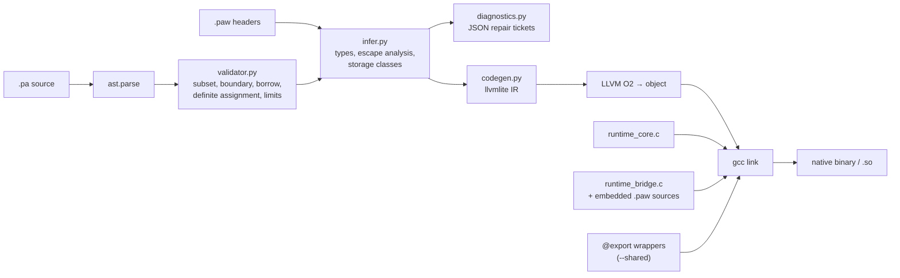

# Pa — Architecture & Engineering Specification

> **Inspired by Python, 100 % Python-syntax compatible. Written by AI, auditable by humans.**

Pa (`.pa`) is a systems language whose source files are valid Python syntax. Function bodies carry no type noise
(types are inferred), data lives in contiguous C++-style memory with deterministic RAII and no garbage collector, and
the code is compiled through LLVM to native machine code. The Python ecosystem is reached through typed, checked,
replayable bridge modules (`.paw`).

| | |
|---|---|
| Version | 0.1.0 (alpha: the language and ABI may still change) |
| License | MIT |
| Platform | Linux x86-64, CPython 3.11–3.13 (headers + shared `libpython`), `gcc` |
| Toolchain | `pac` (check, build, lsp, doctor, bundle), VS Code extension, three AI skills |

## Contents

1. [Design principles](#1-design-principles)
2. [Source files and the two-zone architecture](#2-source-files-and-the-two-zone-architecture)
3. [The clean Python subset](#3-the-clean-python-subset)
4. [Type system](#4-type-system)
5. [Memory model](#5-memory-model)
6. [Runtime semantics and faults](#6-runtime-semantics-and-faults)
7. [The `.paw` boundary](#7-the-paw-boundary)
8. [Compiler architecture](#8-compiler-architecture)
9. [Diagnostics for AI agents](#9-diagnostics-for-ai-agents)
10. [Tooling](#10-tooling)
11. [AI skills](#11-ai-skills)
12. [Repository layout](#12-repository-layout)
13. [Testing and verification](#13-testing-and-verification)
14. [Platform support, limits and roadmap](#14-platform-support-limits-and-roadmap)

> **Inspired by Python, 100 % Python-syntax compatible. Written by AI, auditable by humans.**

Pa (`.pa`) is a systems language whose source files are valid Python syntax. Function bodies carry no type noise
(types are inferred), data lives in contiguous C++-style memory with deterministic RAII and no garbage collector, and
the code is compiled through LLVM to native machine code. The Python ecosystem is reached through typed, checked,
replayable bridge modules (`.paw`).

| | |
|---|---|
| Version | 0.1.0 (alpha: the language and ABI may still change) |
| License | MIT |
| Platform | Linux, CPython 3.11–3.13 (headers + shared `libpython`), `gcc` |
| Toolchain | `pac` (check, build, lsp, doctor, bundle), VS Code extension, three AI skills |

## Contents

1. [Design principles](#1-design-principles)
2. [Source files and the two-zone architecture](#2-source-files-and-the-two-zone-architecture)
3. [The clean Python subset](#3-the-clean-python-subset)
4. [Type system](#4-type-system)
5. [Memory model](#5-memory-model)
6. [Runtime semantics and faults](#6-runtime-semantics-and-faults)
7. [The `.paw` boundary](#7-the-paw-boundary)
8. [Compiler architecture](#8-compiler-architecture)
9. [Diagnostics for AI agents](#9-diagnostics-for-ai-agents)
10. [Tooling](#10-tooling)
11. [AI skills](#11-ai-skills)
12. [Repository layout](#12-repository-layout)
13. [Testing and verification](#13-testing-and-verification)
14. [Platform support, limits and roadmap](#14-platform-support-limits-and-roadmap)

---

## 1. Design principles

1. **Python syntax, zero type noise.** Every `.pa` file parses with `ast.parse`. Function bodies are never annotated;
   types come from bidirectional inference.
2. **Contiguous memory, deterministic lifetime.** Lists are flat arrays (`[N x T]`, `{T*, len, cap}`), never arrays of
   `PyObject*`. Heap storage is freed by RAII at scope exit; there is no GC and no reference counting.
3. **Host-first.** Pa owns `main()`, the control flow and all compute. Python libraries are a sandboxed tool box
   behind a locked boundary, not the other way round.
4. **The boundary is first-class.** Every crossing is typed, checked in both directions, and reproducible from a JSON
   report (no silent data corruption, no finger-pointing between languages).
5. **Compiler messages are written for AI agents.** Diagnostics are self-contained JSON repair tickets with a causal
   chain and deterministic patches.
6. **Safe by default, lean on demand.** `--mode dev` bounds-checks and deep-lints; `--mode prod` removes the cost.

---

## 2. Source files and the two-zone architecture

| Suffix | Zone | Contents and rules |
|---|---|---|
| `*.pa` | **Native zone** — 100 % compiled to LLVM machine code | Pure Pa subset. May import only `pa`, `pa_lang` and project-local `.paw` modules (`PA_E001` otherwise). No third-party Python imports. |
| `*.paw` | **Crossing zone** — runs in an embedded CPython | Standard Python: import numpy, pandas, requests, PIL, … The only hard rule: every public (non-`_`) function has a fully annotated, static **In → Out signature**, which plays the role of a C header. |
| `*.py` | **Thin shell** (optional) | For frameworks that own the event loop (FastAPI, Flask, Django, Streamlit, Gradio). Contains no business logic. |

### 2.1 Default mode: Host-First

`main.pa` (and optional `<domain>.pa` modules) own `main()`, the program loop, state machines and every compute-heavy
routine. `.paw` modules are stateless adapters: whatever dynamic object a library creates (DataFrame, Response, ORM
instance, PIL image) is created, consumed and destroyed **inside** the `.paw`; only scalars, strings and flat numeric
buffers cross the boundary.

**Batching rule.** A boundary call inside a loop (`for`, `while`, comprehension — directly or through a helper
function) is an error (`PA_E002`). Pack the inputs on the Pa side, cross once, and iterate over the batched result.

### 2.2 Exception mode: framework-driven apps

When a Python framework owns the main loop, keep it as a thin router shell and push all logic into Pa:

```
HTTP request → .py route: extract raw params (clean in)
             → call an @export function of the compiled .so
             → serialize the result (clean out) → response
```

`pac build --shared` produces a shared library whose `@export` functions are guarded (section 8.5): a fault returns an
error to the host instead of killing the process. See `examples/web_shell/` (FastAPI).

---

## 3. The clean Python subset

### 3.1 Whitelist and blacklist

| Aspect | Allowed | Rejected (diagnostic) |
|---|---|---|
| Annotations | `@struct` fields; `@export` and `.paw` signatures (all parameters + return); `-> T` on **any** function (the "Out", written by default) | Annotations inside function bodies or on non-export parameters (`PA_E005`); `Any` / `Union` / `Optional` (`PA_E005`); `@export` without full annotations (`PA_E081`); a `-> T` that disagrees with the body (`PA_E085`) |
| Data | scalars, `str`, homogeneous lists, `@struct` | heterogeneous lists (`PA_E030`), `dict` / `set` / `tuple` (`PA_E031`) |
| Control flow | `if/elif/else`, `for … in range(...)`, `for x in list`, `while`, `break`, `continue`, guard-clause `return` | `try/except`, `with`, `yield`, `await`, `global`, `nonlocal`, `del` (`PA_E003`) |
| Functions | plain top-level functions, keyword calls | closures, `lambda`, nested functions, `*args/**kwargs`, `eval/exec`, reflection (`getattr`, `type`, …), metaclasses (`PA_E003`) |
| Slices & concatenation | `s[i]`, `span(arr, start, len)` | `arr[1:5]`, `a + b` on lists, `.extend()` (`PA_E071`) |

### 3.2 Readability limits (enforced)

| Limit | Value | Code |
|---|---|---|
| Lines per function | ≤ 40 | `PA_E060` |
| Cyclomatic complexity | ≤ 8 | `PA_E061` |
| Nesting depth | ≤ 3 | `PA_E062` |
| Positional arguments in a call | ≤ 2 (more must use keywords) | `PA_E051` |

Calls with more than four keyword arguments should be broken over several vertically aligned lines.

### 3.3 Statements the compiler tracks for you

- **Definite assignment** (`PA_E088`): a variable must be assigned on every path before use.
- **One type per variable** (`PA_E086`): a name may widen `int → float` but never changes kind or fixed length.
- **No mutation while iterating** (`PA_E087`): no `append`, `mut(v)` or rebinding of `v` inside `for x in v`.
- **Constant indexes** are checked at compile time (`PA_E073` for negative ones, a compile error past a fixed length).

---

## 4. Type system

### 4.1 Scalars and aliases

| Pa type | Python spelling | Size | Notes |
|---|---|---|---|
| `i64` | **`int`** (default) | 8 B | Default integer for literals, `range` variables and `int(x)`. Wraps on overflow. |
| `f64` | **`float`** (default) | 8 B | Default float. |
| `i32`, `u8`, `f32` | same | 4 / 1 / 4 B | Narrow types, written **only** deliberately (struct packing, big arrays, C ABI). The editor shows them loudly. |
| `bool` | `bool` | 1 B | |
| `str_view` | `str` | 16 B | Read-only `{u8*, len}` view (string literals, `.paw` string arguments). |
| `void` | — | 0 | |

`int` is an alias of `i64` and `float` of `f64` everywhere annotations are allowed (`list[float, 16]`, `Vec[int]`,
`span[float]`). Mixed arithmetic promotes (`i32 + i64 → i64`, `int + float → f64`); `/` is always a float division.
Numeric results are coerced to a declared return type (`-> float` may `return 1`).

### 4.2 Aggregates

| Type | Spelling | Layout | Where it lives |
|---|---|---|---|
| Fixed list | `list[T, N]`, `[a, b, c]`, `[x] * N` | `[N x T]`, nested lists flatten | stack (total ≤ 64 KB) |
| Stack-bounded vec | inferred | `{T*, len, cap}` over a stack buffer | stack, no `malloc` |
| Heap vec | `Vec[T]`, inferred | `{T*, len, cap}` | heap, freed by RAII |
| Owned string | `String` (from `a + b`) | `{u8*, len, cap}` | heap, freed by RAII |
| Struct | `@struct class` with annotated fields | C layout, natural alignment; nested structs and fixed-list fields allowed | stack / inside vecs (AoS) |
| Pointer | `ptr[T]` | `T*` | from `alloc`; never bounds-checked |
| Span | `span[T]` | `{T*, len}` by value | borrowed view |

### 4.3 Inference

Bidirectional, per function, iterated to a fixed point over call sites (parameter types flow from callers; return
types flow back). Empty lists take their element type from the first `append`, or from a callee's direct `append` when the
list is passed once through `mut(...)` (otherwise `PA_E011`). `[0] * 0` / `[0.0] * 0` declares a typed empty vec.
Module-level `int`, `float`, `bool` and `str` constants (and arithmetic on them) are folded at compile time.

---

## 5. Memory model

### 5.1 Value semantics and borrowing

- **Assignment copies.** `b = a` deep-copies arrays, structs and vecs (`llvm.memcpy`; a single stack copy above 4 KB
  raises `PA_W001`). Pointers cannot be aliased by bare assignment (`PA_E070`).
- **Calls borrow.** Containers and structs are passed as zero-copy **read-only** borrows. A callee that mutates a
  parameter (`append`, `x[i] = …`, `p.f = …`) requires the caller to write `mut(x)` (`PA_E050`).
- **No aliasing with `mut`.** The same container may not be passed twice in one call when one occurrence is `mut(...)`
  (`PA_E089`). Scalar subscript or field reads (`f(mut(v), v[i])`) are loaded by value first and are allowed.

### 5.2 Storage decision tree

Every list is compiled to contiguous flat memory according to escape analysis:

| Level | Condition | Result |
|---|---|---|
| **1 — stack** | scalars, structs, constant-length lists (≤ 64 KB total); a dynamic list that does not escape and has a known constant upper bound on its appends (e.g. `for i in range(64)`) | `[N x T]` or a stack-bounded vec: `append` is a pointer write plus `len += 1`, zero `malloc` |
| **2 — heap vec** | unknown bound, escapes via `return` / struct field, or above 64 KB | `{T*, len, cap}`, starts at `cap = 16` and doubles; freed before every `return` unless ownership moves to the caller |
| **3 — hard error** | heterogeneous list (`PA_E030`, with a generated `@struct` surgery patch); uninferable empty list (`PA_E011`); a `span` of a local returned (`PA_E040`); an `alloc` that leaks or is used after `free` (`PA_E004`) | compilation stops |

### 5.3 Building lists

| Form | Result |
|---|---|
| `[a, b, c]` | `list[T, 3]` on the stack |
| `[x] * N` (constant, ≤ 64 KB) | `list[T, N]` on the stack |
| `[x] * n` (runtime `n`, `n ≤ 0`, or > 64 KB) | heap `Vec[T]`, RAII-freed, negative `n` clamps to 0 |
| `[[0.0] * W] * H` | contiguous 2-D array, indexed `m[i, j]` (≡ `m[i][j]`) |
| `[]` + `append` | stack-bounded vec or heap vec by escape analysis |
| `[0] * 0`, `[0.0] * 0` | typed empty heap vec (100 % valid Python) |

### 5.4 Strings

`str_view` is a read-only `{ptr, len}` view. `a + b` (including chains) and `s += x` produce an owned `String`: one
allocation per chain, freed by RAII, ownership transferred on `return`, deep-copied on `b = a`. Supported: `len(s)`,
`s[i]` (a `u8`), `for ch in s`, `==` / `!=`, `print`, passing as `str_view` to a `.paw`.
**A temporary `String` must be bound to a local** (`PA_E072`): `tmp = a + b; f(tmp)`, never `f(a + b)`.
Strings are UTF-8 **bytes** (`len("héllo")` is 6); slicing is not supported (`PA_E071`).

### 5.5 Manual memory and views

`alloc(T, n)` / `free(p)` exist for FFI-style code; `span(arr, start, len)` is a zero-copy view; `copy(dst, src, count)`
is `memcpy`. Pointer bugs are diagnosed statically where possible (`PA_E004`, `PA_E040`, `PA_E070`).

---

## 6. Runtime semantics and faults

### 6.1 Differences from Python (by design)

| Topic | Pa behaviour | Python |
|---|---|---|
| Integer `//`, `%` | C semantics: truncation toward zero (`-7 // 2 == -3`, `-7 % 3 == -1`) | floors |
| Float `%` | C `fmod` (`-1.0 % 6.283 == -1.0`) | floored |
| Integer `//`, `%` by zero | `ZeroDivisionError` fault (both modes); `INT_MIN // -1` does not trap | exception |
| Float `/` by zero | IEEE `inf` / `nan` | exception |
| Integer overflow | wraps in 64 bits | big integers |
| Indexing | `0 ≤ i < len` only; **negative indexes are out of range** (write `a[len(a) - 1]`) | negative indexes wrap |
| `range(a, b, step)` | variable step allowed; `step == 0` → `ValueError`; direction chosen before the loop | same |
| Strings | UTF-8 bytes | code points |
| `print` | Python `repr` formatting (`15.0`, `0.30000000000000004`, `1e+20`, `True`) | — |
| Variable types | one type per variable | dynamic |

### 6.2 Faults

A runtime fault never corrupts state silently:

- **Executables:** write a JSON report (`pa_runtime_fault.json` or `pa_boundary_fault.json`, or the path in
  `PA_FAULT_PATH`), print a one-line summary and exit with code **70**.
- **Shared libraries:** the fault is recorded in thread-local storage and control returns to the host (section 8.5).

Runtime fault report: `{"mode", "kind", "detail", "function", "line"}` with `kind` one of `ZeroDivisionError`,
`IndexError`, `ValueError`, `OverflowError`. Narrowing never truncates silently: an `int` passed to a `u8`/`i32`
parameter is range-checked (a literal that does not fit is a compile error).

### 6.3 Modes

| | `--mode dev` (default) | `--mode prod` |
|---|---|---|
| Bounds checks on every variable index (incl. each dimension of `m[i, j]`, `span`, `str`) | yes (`IndexError`) | no (C-like) |
| Division by zero, `range` step 0, `.paw` narrowing | checked | checked |
| Narrowing on assignments / arguments / fields | checked | not checked |
| `.paw` static lint (section 7.5) | deep | signatures only |
| Boundary customs | full element scans, snapshots up to 1024 elements | scalar customs, no per-element NaN scan, snapshots up to 16 elements |

Ship only code that is clean in dev.

---

## 7. The `.paw` boundary

### 7.1 Signatures

```python
# np_ops.paw — free to import numpy, but the signature is locked
import numpy as np

def sum_array(arr: span[float]) -> float:
    return float(np.sum(np.frombuffer(arr, dtype=np.float64)))
```
```python
# main.pa — reads like a normal module; x is inferred as float
import np_ops

def main() -> int:
    arr = [1.0, 2.0, 3.0, 4.0]
    x = np_ops.sum_array(arr)
    return 0
```

| Direction | Allowed types |
|---|---|
| Parameters | `i32 i64 u8 f32 f64 bool` (and `int`/`float`), `str_view`, `span[T]`, `list[T, N]`, `Vec[T]` (T numeric) |
| Return | numeric scalar, `Vec[T]`, or `void` — **never a string** (return `Vec[u8]` and let Pa own the bytes) |

Errors: missing signature `PA_E080`, unsupported type `PA_E082`, mismatching call `PA_E090` (a float is never accepted for
an integer parameter). Inside a `.paw`, the type names (`span`, `Vec`, `i32`, …) and `@allow_nan` are pre-defined builtins.

### 7.2 Front end

When `infer.py` meets `import x` and `x.paw` exists, it parses **only** the public function signatures into the symbol
table. `x.f(arr)` is then typed statically; the Python body is never analysed by the compiler.

### 7.3 Back end: marshaling stubs

`codegen.py` does not compile `.paw` files. Each call site emits a stub that fills an argument table and calls
`pa_call_paw(module, function, args, nargs, ret_tag, ret_elem, flags, &ret)` in `runtime_bridge.c`:

- scalars → `PyLong` / `PyFloat` / `PyBool`; strings → `str`;
- contiguous buffers (`list[T, N]`, `Vec[T]`, `span[T]`) → `PyMemoryView_FromMemory` cast to the element format: **zero
  copy**, so `np.frombuffer(arr, …)` reads Pa memory directly (the view is read-only);
- the result is checked, then unboxed into native values (`Vec[T]` results are copied into a malloc'd buffer owned by Pa).

### 7.4 Two-way customs

| Direction | Checked |
|---|---|
| **Out-bound** `PA_TO_PY_IN` | NaN / Inf (scalars; buffers in dev), `NULL` pointer with length > 0, negative length, narrowing range |
| **In-bound** `PY_TO_PA_OUT` | `None`, NaN / Inf, type drift (e.g. `int` where `float` was declared, `bool` for an integer), integer out of range, buffer format mismatch, Python exceptions |
| **Start-up** `STARTUP` | embedded Python cannot be initialised (section 7.7) |

Any violation fuses immediately and writes `pa_boundary_fault.json`:

```json
{
  "mode": "dev",
  "direction": "PY_TO_PA_OUT",
  "worker": "np_ops.sum_array",
  "violation": "return: None where f64 was declared",
  "in_payload_snapshot": [{"index": 0, "type": "buffer<f64>", "len": 4, "truncated": false, "values": [1, 2, 3, 4]}]
}
```

**Deterministic bisection (replay in seconds).** Replay `in_payload_snapshot` against the bare `.paw` function: valid
input and wrong output means the `.paw` is at fault; correct worker output but wrong final state means the Pa core is.
`@allow_nan` on a `.paw` function waives only the NaN/Inf checks for that function, in both directions.

### 7.5 Static lint of `.paw` bodies (dev mode)

Beyond the signature rules, dev builds lint every imported `.paw`: returns that cannot match the declared type
(`None`, an `int` literal for `f64`, `float()`/`int()`/`len()` mismatches), paths that fall off the end and return `None`
(`PA_E083`), and writes into read-only input buffers (`PA_E084`).

### 7.6 Embedding and run-time resolution

Imported `.paw` sources are **embedded in the binary** (no source directory is baked in); the module's `__file__` is
`<embedded>/<name>.paw`, so `.paw` code must not rely on it. The location of CPython is resolved at run time:

| What | Priority (first match wins) |
|---|---|
| `.paw` sources | `PA_PATH` directories (live-edit override) → sources embedded in the binary |
| Python home | `PA_PYTHON_HOME` → `PYTHONHOME` → `<binary dir>/python-home` → build-time default (only if it contains a stdlib) |
| `sys.path` | `PA_PYPATH` → `$VIRTUAL_ENV/lib/pythonX.Y/site-packages` → build-time defaults (only entries that still exist) |

Build-time defaults are the building interpreter's prefix and its `purelib`/`platlib`; `--python-home` and
`--python-path` override them and `--relocatable` bakes none. A binary that links no `.paw` links no Python at all.
Shared libraries loaded into a running Python reuse the host interpreter and never touch `PYTHONHOME`.

### 7.7 Deployment and diagnosing a missing Python

A missing `libpython` makes the **dynamic loader** abort before any Pa code runs (`error while loading shared
libraries: libpython3.12.so.1.0`, exit 127), so detection lives in the toolchain:

- `pac doctor` — checks the build machine (gcc, llvmlite, `Python.h`, shared `libpython`) and prints install hints.
- `pac doctor ./app` — reads the binary's ELF `DT_NEEDED` / `RPATH` / `RUNPATH`, resolves each library with the loader's
  search order, lists what is missing, shows which Python home will be used and how to fix it (exit code 1 if it cannot start).
- `pac bundle ./app [--with-stdlib]` — copies `libpython3.X.so` next to the binary (found through the `$ORIGIN` rpath);
  `--with-stdlib` also ships a trimmed stdlib as `./python-home`, giving a binary that runs with no environment variables.
  Third-party packages (numpy, …) are never bundled: provide them with `PA_PYPATH` / `VIRTUAL_ENV`.
- After the loader succeeds, a bad or missing Python home becomes a friendly `STARTUP` fault (exit 70) naming the fix.

---

## 8. Compiler architecture

### 8.1 Pipeline



### 8.2 Modules

| File | Role |
|---|---|
| `pa_lang/types.py` | Memory-layout type system, intrinsics and builtins registry, `int`/`float` display names |
| `pa_lang/infer.py` | Zero-annotation inference to a fixed point, stack-bound escape analysis, `Vec` promotion, alias and temporary-string checks, editor hints |
| `pa_lang/validator.py` | Subset rules, `.paw` import rules, batching, borrow (`mut`) checks, definite assignment, readability limits |
| `pa_lang/paw.py` | `.paw` header parsing, signature validation, dev-mode deep lint |
| `pa_lang/diagnostics.py` | Diagnostic catalogue, JSON tickets, `@struct` surgery for `PA_E030` |
| `pa_lang/codegen.py` | llvmlite IR generation (libc and runtime symbols declared up front), bounds/division/narrowing checks, marshaling stubs |
| `pa_lang/build.py` | Object emission and linking, embedding of `.paw` sources, `@export` wrappers, Python path baking |
| `pa_lang/runtime_core.c` | Fault raising, thread-local guards for shared libraries, Python-compatible `print` helpers (no Python dependency, always linked) |
| `pa_lang/runtime_bridge.c` | Embedded CPython, customs, marshaling, start-up diagnostics |
| `pa_lang/doctor.py` | ELF inspection, `pac doctor`, `pac bundle` |
| `pa_lang/lsp_server.py` | Language server |
| `pa_lang/cli.py` | `pac` entry point |

### 8.3 Inference and escape analysis

Per function, one walk assigns types to every expression; a list created by `[]` is a placeholder whose element type is
fixed by its first `append`. A second analysis computes, per list, whether it escapes (returned, stored in a struct, handed
to `mut(...)`) and an upper bound on its appends (constant `range` bounds multiplied through nested loops;
`while` and variable bounds are unbounded). Result: stack-bounded vec if it does not escape, is bounded and ≤ 64 KB;
otherwise a heap vec. Call-site argument types and return types are propagated until nothing changes.

### 8.4 Code generation

- Scalars are SSA values; fixed lists, vecs and structs are handled by address. `StackVec` and `Vec` share the header
  `{T*, i64 len, i64 cap}` (a stack vec's pointer targets an entry-block `alloca`).
- Functions take scalars, views and pointers by value and aggregates by pointer; aggregates are returned by value.
- Emitted checks: bounds (dev), integer division by zero, `range` step, narrowing, and RAII `free` on every exit path of
  heap locals that are not returned.
- LLVM `-O2` runs before object emission.

### 8.5 `--shared` libraries and the guarded ABI

`@export` functions keep their names; the compiler renames the implementation (`pa_impl_<name>`) and links a C wrapper
that installs a `setjmp` guard. A fault (Pa runtime or `.paw` boundary, after releasing the GIL) records the error in
thread-local storage and returns `0` to the host, which polls `pa_error_code()`, `pa_error_message()`, `pa_error_json()`
and clears it with `pa_error_clear()` (see `examples/web_shell/app.py: checked`).

| Pa parameter | C ABI |
|---|---|
| `int`, `float`, `i32`, `u8`, `f32`, `bool` | by value |
| `span[T]`, `str_view` | `struct { void *p; int64_t n; }` by value |
| `ptr[T]`, `list[T, N]` | pointer to the first element |
| `Vec[T]` | pointer to `{T*, i64 len, i64 cap}` |

---

## 9. Diagnostics for AI agents

`pac check --ai-diagnostic` prints a JSON array of self-contained repair tickets:

| Field | Meaning |
|---|---|
| `code`, `category`, `severity` | stable identifier, family, `error` / `warning` |
| `skill_rule_ref` | the skill rule that explains it |
| `location` | file, line, column |
| `summary` | one-line description |
| `inferred_context` | the types, layouts or values the compiler inferred |
| `causal_chain` | from the definition to the violation |
| `source_context` | the offending line with ±3 lines of source |
| `repair_plan` | `strategy`, `anti_patterns_to_avoid`, `suggested_patches` (deterministic replacement code) |

| Family | Codes |
|---|---|
| Syntax / subset | `PA_E000` syntax error · `PA_E003` forbidden construct · `PA_E031` forbidden data type |
| Host isolation / boundary | `PA_E001` third-party import in `.pa` · `PA_E002` boundary call in a loop · `PA_E080` missing `.paw` signature · `PA_E082` bad boundary type · `PA_E083` `.paw` return mismatch (dev) · `PA_E084` write to read-only input (dev) · `PA_E090` bad `.paw` call |
| Annotations | `PA_E005` forbidden annotation · `PA_E081` incomplete `@export` · `PA_E085` return annotation mismatch |
| Layout / inference | `PA_E011` uninferable empty list · `PA_E030` heterogeneous list (with `@struct` surgery) · `PA_E071` implicit heap slice / concat · `PA_E086` variable changes type · `PA_E088` possibly unassigned |
| Memory safety | `PA_E004` alloc leak / use after free · `PA_E040` span of a local returned · `PA_E070` pointer alias · `PA_E072` temporary `String` · `PA_E073` negative index · `PA_E087` mutation while iterating · `PA_E089` `mut` aliasing |
| Borrow / style | `PA_E050` missing `mut()` · `PA_E051` use keyword arguments · `PA_E060` / `PA_E061` / `PA_E062` size, complexity, nesting |
| Performance | `PA_W001` stack copy above 4 KB (warning) |

`PA_E030` tickets contain a generated `@struct` definition and the rewritten literal, turning a mixed 2-D table into a
contiguous `Vec<Record>` (AoS).

---

## 10. Tooling

### 10.1 `pac`

| Command | Purpose |
|---|---|
| `pac check [--ai-diagnostic] [--mode dev\|prod] PATH…` | Front-end checks on files or directories (`.pa` and `.paw`); exit 1 on errors |
| `pac build FILE [-o OUT] [--mode dev\|prod] [--shared] [--emit-ir] [--python-home P] [--python-path S]… [--relocatable]` | Compile to a native executable or shared library |
| `pac lsp` | Language server over stdio |
| `pac doctor [BINARY]` | Environment or binary diagnosis (section 7.7) |
| `pac bundle BINARY [--dest D] [--with-stdlib]` | Ship `libpython` (and a stdlib) next to a binary |
| `pac --version` | Print the version |

### 10.2 Environment variables

| Variable | Effect |
|---|---|
| `PA_PATH` | Directories searched first for live `.paw` files |
| `PA_PYTHON_HOME`, `PA_PYPATH` | Python home and `sys.path` entries (run time) |
| `PA_FAULT_PATH` | Where fault reports are written |
| `PA_LSP_AUTORELOAD=0`, `PA_LSP_WATCH_DIR` | Disable / redirect the language server's auto-restart |
| `PA_ALLOW_UNSUPPORTED_PLATFORM=1` | Attempt `pac build` off Linux |
| `PA_*_DATA_DIR` | Data directory of an example (default: current directory) |

### 10.3 Language server and VS Code extension

`pac lsp` provides diagnostics, inlay hints and hover. It watches its own source files and exits when they change; the
client restarts it, so the editor never shows stale diagnostics.

- **Inlay hints** (`pa.inlayHints.detail`): `simple` (default) shows Python names only — `: int`, `: float`,
  `: list[float]`, `: str`, `: Point`, `[🌉 .paw → float]` — while narrow types stay loud (`: i32`, `: u8`).
  `detailed` adds sizes and memory strategy — `: list[float, 16] (128B flat)`, `: StackVec<int, max=64> (Zero-Heap)`,
  `: Vec<int> (RAII)`, `[free: RAII]`, `[memcpy 128B]`, `[🌉 .paw FFI -> float]`.
- **Hover audit card**: `int (i64, 8B, stack)`, LLVM layout, size and element stride, stack/heap placement, the line(s)
  where RAII inserts `free`, the function's cyclomatic complexity, and a warning for narrow types.
- **Extension** (`vscode-pa/`): registers the languages `pa` and `paw`; the TextMate grammar inherits Python's
  (`source.paw → source.pa → source.python`) and colours the intrinsics (`mut span copy alloc free`), the decorators
  (`@struct @export @allow_nan`) and the Pa types. Commands: restart the server, build (dev / prod), check with
  `--ai-diagnostic`. Settings: `pa.pacPath` (default: `<workspace>/.venv/bin/pac`, then `pac`), `pa.inlayHints.detail`.

---

## 11. AI skills

Three skill packs in `skills/` drive coding agents; each ends in the same gate (`pac check --ai-diagnostic` until green,
dev mode first).

| Skill | When | Core workflow |
|---|---|---|
| `pa-coder` | New projects | Host-First skeleton (or a thin web shell) → write zero-annotation `.pa` with `-> T` on every function → contiguous data layout (`@struct`, `[x] * n`, `[0] * 0`) → quarantine libraries in `.paw` → self-heal with tickets |
| `py-to-pa` | Accelerate a Python repository | **Three-colour gate** per module — 🟢 pure compute: convert fully; 🟡 libraries or web framework: invert control (Pa host + `.paw`, or a thin router shell); 🔴 heavy metaprogramming: stop with `STATUS: RED - Keep in .py worker layer + <one-sentence blocker>` — then convert, then prove with a differential test and timing report |
| `cpp-to-pa` | Modernise legacy C++ | Map `std::array`, `std::vector`, `struct`, `std::span`, `const T&` one-to-one to fixed lists, vecs, `@struct`, `span`, default borrows; strip macros and raw owning pointers; byte-level differential fuzzing |

Hard rules the skills enforce (most are also compiler diagnostics): temporary strings bound to locals; empty lists
declared with `[0] * 0`; no slicing; no negative indexes; one type per variable; assign before use; never mutate a list
being iterated; no `mut` aliasing; one single-line comment above every non-obvious function; explicit awareness of the
integer / float `%` and `//` semantics when porting; `.paw` modules never return strings.

---

## 12. Repository layout

```
pa/
├── pyproject.toml            package metadata (entry point: pac = pa_lang.cli:main)
├── LICENSE  README.md  ARCHITECTURE.md  CHANGELOG.md  RELEASING.md
├── pa_lang/                  compiler, runtimes, language server
├── skills/                   pa-coder · py-to-pa · cpp-to-pa
├── vscode-pa/                VS Code extension (grammar, client, tests)
├── examples/
│   ├── pipeline_demo/        host-first demo (.pa + .paw)
│   ├── web_shell/            FastAPI router shell over a guarded .so
│   ├── benchmark/            CPython vs Pa loops
│   ├── utm/ delaunator/ levenshtein/ kdtree/    differential benchmarks
├── tests/                    pytest suites
└── .github/workflows/        CI and release
```

---

## 13. Testing and verification

| Suite | Covers |
|---|---|
| `test_infer`, `test_validator` | inference, storage classes, escape analysis, every diagnostic |
| `test_codegen`, `test_features`, `test_hardening` | end-to-end compile-and-run, runtime faults, big lists, strings, 2-D indexing, narrowing, guarded shared libraries, the FastAPI shell |
| `test_lsp`, `test_lsp_stdio`, `vscode-pa/test` | hints, hover, real LSP JSON-RPC round trips, TextMate scopes |
| `test_relocation`, `test_doctor` | embedded `.paw`, run-time Python resolution, `pac doctor` / `pac bundle`, start-up faults |
| `test_release` | single-sourced version, metadata, license, workflows, platform guard |

Each example under `examples/` ships a verification script that compares the native binary against a pure-Python
reference on randomized data (exact for integers and sets, `< 1e-9` for floats) and prints a speed-up table:

| Example | Stresses | Indicative compute speed-up* |
|---|---|---|
| `utm` | float math, `libm`, special-zone branching, 100 k points | ≈ 165–250× |
| `delaunator` | dynamic `Vec` growth, `while` loops, half-edge index jumps | ≈ 17× |
| `levenshtein` | byte spans, rolling arrays, flattened 2-D DP, `String` RAII, 50 k pairs | ≈ 65–95× |
| `kdtree` | recursion, nested `@struct`, manual-stack search, PIL rendering through a `.paw` | ≈ 22–29× |
| `benchmark` | 5·10⁷-iteration integer and float loops | ≈ 110× |

\* Measured on the development machine against CPython 3.12; indicative only.

---

## 14. Platform support, limits and roadmap

**Supported:** Linux x86-64 (aarch64 is expected to work but is untested), CPython 3.11–3.13 with headers and a shared
`libpython`, `gcc`. `pac check`, `pac lsp` and `pac build --emit-ir` are platform independent. `pac build` refuses other
platforms (`PA_ALLOW_UNSUPPORTED_PLATFORM=1` overrides) and `doctor` / `bundle` only understand ELF binaries and
`/proc/self/exe`.

**Current limits**

- No string slicing; a `.paw` cannot return a string; structs cannot cross the `.paw` boundary; `@struct` fields cannot be
  `Vec`s yet (they would need nested RAII destructors).
- Element-type inference for an empty list handed through `mut(...)` follows one call level; use `[0] * 0` for deeper chains.
- Helpers are monomorphic over container layouts: do not pass a stack list to a parameter that also receives a heap `Vec`.
- Deep recursion with large stack-bounded vecs (up to 64 KB per frame) can exhaust the stack; there is no recursion guard.
- Fault reports are written to a fixed file name per process (set `PA_FAULT_PATH` when running several processes in one directory).
- The first `.paw` call pays CPython start-up and import cost (about 0.1 s with numpy on the development machine).
- Not supported: `**`, `dict` / `set` / `tuple`, closures, generators, `try/except`. `f32` values print as the widened `f64`.

**Roadmap:** nested `Vec` fields with RAII, a generic `**` and integer power, string slicing as spans, macOS and Windows
toolchains, a static `libpython` option for self-contained binaries, a recursion-depth guard.

`alloc(T, n)` / `free(p)` exist for FFI-style code; `span(arr, start, len)` is a zero-copy view; `copy(dst, src, count)`
is `memcpy`. Pointer bugs are diagnosed statically where possible (`PA_E004`, `PA_E040`, `PA_E070`).

---

## 6. Runtime semantics and faults

### 6.1 Differences from Python (by design)

| Topic | Pa behaviour | Python |
|---|---|---|
| Integer `//`, `%` | C semantics: truncation toward zero (`-7 // 2 == -3`, `-7 % 3 == -1`) | floors |
| Float `%` | C `fmod` (`-1.0 % 6.283 == -1.0`) | floored |
| Integer `//`, `%` by zero | `ZeroDivisionError` fault (both modes); `INT_MIN // -1` does not trap | exception |
| Float `/` by zero | IEEE `inf` / `nan` | exception |
| Integer overflow | wraps in 64 bits | big integers |
| Indexing | `0 ≤ i < len` only; **negative indexes are out of range** (write `a[len(a) - 1]`) | negative indexes wrap |
| `range(a, b, step)` | variable step allowed; `step == 0` → `ValueError`; direction chosen before the loop | same |
| Strings | UTF-8 bytes | code points |
| `print` | Python `repr` formatting (`15.0`, `0.30000000000000004`, `1e+20`, `True`) | — |
| Variable types | one type per variable | dynamic |

### 6.2 Faults

A runtime fault never corrupts state silently:

- **Executables:** write a JSON report (`pa_runtime_fault.json` or `pa_boundary_fault.json`, or the path in
  `PA_FAULT_PATH`), print a one-line summary and exit with code **70**.
- **Shared libraries:** the fault is recorded in thread-local storage and control returns to the host (section 8.5).

Runtime fault report: `{"mode", "kind", "detail", "function", "line"}` with `kind` one of `ZeroDivisionError`,
`IndexError`, `ValueError`, `OverflowError`. Narrowing never truncates silently: an `int` passed to a `u8`/`i32`
parameter is range-checked (a literal that does not fit is a compile error).

### 6.3 Modes

| | `--mode dev` (default) | `--mode prod` |
|---|---|---|
| Bounds checks on every variable index (incl. each dimension of `m[i, j]`, `span`, `str`) | yes (`IndexError`) | no (C-like) |
| Division by zero, `range` step 0, `.paw` narrowing | checked | checked |
| Narrowing on assignments / arguments / fields | checked | not checked |
| `.paw` static lint (section 7.5) | deep | signatures only |
| Boundary customs | full element scans, snapshots up to 1024 elements | scalar customs, no per-element NaN scan, snapshots up to 16 elements |

Ship only code that is clean in dev.

---

## 7. The `.paw` boundary

### 7.1 Signatures

```python
# np_ops.paw — free to import numpy, but the signature is locked
import numpy as np

def sum_array(arr: span[float]) -> float:
    return float(np.sum(np.frombuffer(arr, dtype=np.float64)))
```
```python
# main.pa — reads like a normal module; x is inferred as float
import np_ops

def main() -> int:
    arr = [1.0, 2.0, 3.0, 4.0]
    x = np_ops.sum_array(arr)
    return 0
```

| Direction | Allowed types |
|---|---|
| Parameters | `i32 i64 u8 f32 f64 bool` (and `int`/`float`), `str_view`, `span[T]`, `list[T, N]`, `Vec[T]` (T numeric) |
| Return | numeric scalar, `Vec[T]`, or `void` — **never a string** (return `Vec[u8]` and let Pa own the bytes) |

Errors: missing signature `PA_E080`, unsupported type `PA_E082`, mismatching call `PA_E090` (a float is never accepted for
an integer parameter). Inside a `.paw`, the type names (`span`, `Vec`, `i32`, …) and `@allow_nan` are pre-defined builtins.

### 7.2 Front end

When `infer.py` meets `import x` and `x.paw` exists, it parses **only** the public function signatures into the symbol
table. `x.f(arr)` is then typed statically; the Python body is never analysed by the compiler.

### 7.3 Back end: marshaling stubs

`codegen.py` does not compile `.paw` files. Each call site emits a stub that fills an argument table and calls
`pa_call_paw(module, function, args, nargs, ret_tag, ret_elem, flags, &ret)` in `runtime_bridge.c`:

- scalars → `PyLong` / `PyFloat` / `PyBool`; strings → `str`;
- contiguous buffers (`list[T, N]`, `Vec[T]`, `span[T]`) → `PyMemoryView_FromMemory` cast to the element format: **zero
  copy**, so `np.frombuffer(arr, …)` reads Pa memory directly (the view is read-only);
- the result is checked, then unboxed into native values (`Vec[T]` results are copied into a malloc'd buffer owned by Pa).

### 7.4 Two-way customs

| Direction | Checked |
|---|---|
| **Out-bound** `PA_TO_PY_IN` | NaN / Inf (scalars; buffers in dev), `NULL` pointer with length > 0, negative length, narrowing range |
| **In-bound** `PY_TO_PA_OUT` | `None`, NaN / Inf, type drift (e.g. `int` where `float` was declared, `bool` for an integer), integer out of range, buffer format mismatch, Python exceptions |
| **Start-up** `STARTUP` | embedded Python cannot be initialised (section 7.7) |

Any violation fuses immediately and writes `pa_boundary_fault.json`:

```json
{
  "mode": "dev",
  "direction": "PY_TO_PA_OUT",
  "worker": "np_ops.sum_array",
  "violation": "return: None where f64 was declared",
  "in_payload_snapshot": [{"index": 0, "type": "buffer<f64>", "len": 4, "truncated": false, "values": [1, 2, 3, 4]}]
}
```

**Deterministic bisection (replay in seconds).** Replay `in_payload_snapshot` against the bare `.paw` function: valid
input and wrong output means the `.paw` is at fault; correct worker output but wrong final state means the Pa core is.
`@allow_nan` on a `.paw` function waives only the NaN/Inf checks for that function, in both directions.

### 7.5 Static lint of `.paw` bodies (dev mode)

Beyond the signature rules, dev builds lint every imported `.paw`: returns that cannot match the declared type
(`None`, an `int` literal for `f64`, `float()`/`int()`/`len()` mismatches), paths that fall off the end and return `None`
(`PA_E083`), and writes into read-only input buffers (`PA_E084`).

### 7.6 Embedding and run-time resolution

Imported `.paw` sources are **embedded in the binary** (no source directory is baked in); the module's `__file__` is
`<embedded>/<name>.paw`, so `.paw` code must not rely on it. The location of CPython is resolved at run time:

| What | Priority (first match wins) |
|---|---|
| `.paw` sources | `PA_PATH` directories (live-edit override) → sources embedded in the binary |
| Python home | `PA_PYTHON_HOME` → `PYTHONHOME` → `<binary dir>/python-home` → build-time default (only if it contains a stdlib) |
| `sys.path` | `PA_PYPATH` → `$VIRTUAL_ENV/lib/pythonX.Y/site-packages` → build-time defaults (only entries that still exist) |

Build-time defaults are the building interpreter's prefix and its `purelib`/`platlib`; `--python-home` and
`--python-path` override them and `--relocatable` bakes none. A binary that links no `.paw` links no Python at all.
Shared libraries loaded into a running Python reuse the host interpreter and never touch `PYTHONHOME`.

### 7.7 Deployment and diagnosing a missing Python

A missing `libpython` makes the **dynamic loader** abort before any Pa code runs (`error while loading shared
libraries: libpython3.12.so.1.0`, exit 127), so detection lives in the toolchain:

- `pac doctor` — checks the build machine (gcc, llvmlite, `Python.h`, shared `libpython`) and prints install hints.
- `pac doctor ./app` — reads the binary's ELF `DT_NEEDED` / `RPATH` / `RUNPATH`, resolves each library with the loader's
  search order, lists what is missing, shows which Python home will be used and how to fix it (exit code 1 if it cannot start).
- `pac bundle ./app [--with-stdlib]` — copies `libpython3.X.so` next to the binary (found through the `$ORIGIN` rpath);
  `--with-stdlib` also ships a trimmed stdlib as `./python-home`, giving a binary that runs with no environment variables.
  Third-party packages (numpy, …) are never bundled: provide them with `PA_PYPATH` / `VIRTUAL_ENV`.
- After the loader succeeds, a bad or missing Python home becomes a friendly `STARTUP` fault (exit 70) naming the fix.

---

## 8. Compiler architecture

### 8.1 Pipeline


### 8.2 Modules

| File | Role |
|---|---|
| `pa_lang/types.py` | Memory-layout type system, intrinsics and builtins registry, `int`/`float` display names |
| `pa_lang/infer.py` | Zero-annotation inference to a fixed point, stack-bound escape analysis, `Vec` promotion, alias and temporary-string checks, editor hints |
| `pa_lang/validator.py` | Subset rules, `.paw` import rules, batching, borrow (`mut`) checks, definite assignment, readability limits |
| `pa_lang/paw.py` | `.paw` header parsing, signature validation, dev-mode deep lint |
| `pa_lang/diagnostics.py` | Diagnostic catalogue, JSON tickets, `@struct` surgery for `PA_E030` |
| `pa_lang/codegen.py` | llvmlite IR generation (libc and runtime symbols declared up front), bounds/division/narrowing checks, marshaling stubs |
| `pa_lang/build.py` | Object emission and linking, embedding of `.paw` sources, `@export` wrappers, Python path baking |
| `pa_lang/runtime_core.c` | Fault raising, thread-local guards for shared libraries, Python-compatible `print` helpers (no Python dependency, always linked) |
| `pa_lang/runtime_bridge.c` | Embedded CPython, customs, marshaling, start-up diagnostics |
| `pa_lang/doctor.py` | ELF inspection, `pac doctor`, `pac bundle` |
| `pa_lang/lsp_server.py` | Language server |
| `pa_lang/cli.py` | `pac` entry point |

### 8.3 Inference and escape analysis

Per function, one walk assigns types to every expression; a list created by `[]` is a placeholder whose element type is
fixed by its first `append`. A second analysis computes, per list, whether it escapes (returned, stored in a struct, handed
to `mut(...)`) and an upper bound on its appends (constant `range` bounds multiplied through nested loops;
`while` and variable bounds are unbounded). Result: stack-bounded vec if it does not escape, is bounded and ≤ 64 KB;
otherwise a heap vec. Call-site argument types and return types are propagated until nothing changes.

### 8.4 Code generation

- Scalars are SSA values; fixed lists, vecs and structs are handled by address. `StackVec` and `Vec` share the header
  `{T*, i64 len, i64 cap}` (a stack vec's pointer targets an entry-block `alloca`).
- Functions take scalars, views and pointers by value and aggregates by pointer; aggregates are returned by value.
- Emitted checks: bounds (dev), integer division by zero, `range` step, narrowing, and RAII `free` on every exit path of
  heap locals that are not returned.
- LLVM `-O2` runs before object emission.

### 8.5 `--shared` libraries and the guarded ABI

`@export` functions keep their names; the compiler renames the implementation (`pa_impl_<name>`) and links a C wrapper
that installs a `setjmp` guard. A fault (Pa runtime or `.paw` boundary, after releasing the GIL) records the error in
thread-local storage and returns `0` to the host, which polls `pa_error_code()`, `pa_error_message()`, `pa_error_json()`
and clears it with `pa_error_clear()` (see `examples/web_shell/app.py: checked`).

| Pa parameter | C ABI |
|---|---|
| `int`, `float`, `i32`, `u8`, `f32`, `bool` | by value |
| `span[T]`, `str_view` | `struct { void *p; int64_t n; }` by value |
| `ptr[T]`, `list[T, N]` | pointer to the first element |
| `Vec[T]` | pointer to `{T*, i64 len, i64 cap}` |

---

## 9. Diagnostics for AI agents

`pac check --ai-diagnostic` prints a JSON array of self-contained repair tickets:

| Field | Meaning |
|---|---|
| `code`, `category`, `severity` | stable identifier, family, `error` / `warning` |
| `skill_rule_ref` | the skill rule that explains it |
| `location` | file, line, column |
| `summary` | one-line description |
| `inferred_context` | the types, layouts or values the compiler inferred |
| `causal_chain` | from the definition to the violation |
| `source_context` | the offending line with ±3 lines of source |
| `repair_plan` | `strategy`, `anti_patterns_to_avoid`, `suggested_patches` (deterministic replacement code) |

| Family | Codes |
|---|---|
| Syntax / subset | `PA_E000` syntax error · `PA_E003` forbidden construct · `PA_E031` forbidden data type |
| Host isolation / boundary | `PA_E001` third-party import in `.pa` · `PA_E002` boundary call in a loop · `PA_E080` missing `.paw` signature · `PA_E082` bad boundary type · `PA_E083` `.paw` return mismatch (dev) · `PA_E084` write to read-only input (dev) · `PA_E090` bad `.paw` call |
| Annotations | `PA_E005` forbidden annotation · `PA_E081` incomplete `@export` · `PA_E085` return annotation mismatch |
| Layout / inference | `PA_E011` uninferable empty list · `PA_E030` heterogeneous list (with `@struct` surgery) · `PA_E071` implicit heap slice / concat · `PA_E086` variable changes type · `PA_E088` possibly unassigned |
| Memory safety | `PA_E004` alloc leak / use after free · `PA_E040` span of a local returned · `PA_E070` pointer alias · `PA_E072` temporary `String` · `PA_E073` negative index · `PA_E087` mutation while iterating · `PA_E089` `mut` aliasing |
| Borrow / style | `PA_E050` missing `mut()` · `PA_E051` use keyword arguments · `PA_E060` / `PA_E061` / `PA_E062` size, complexity, nesting |
| Performance | `PA_W001` stack copy above 4 KB (warning) |

`PA_E030` tickets contain a generated `@struct` definition and the rewritten literal, turning a mixed 2-D table into a
contiguous `Vec<Record>` (AoS).

---

## 10. Tooling

### 10.1 `pac`

| Command | Purpose |
|---|---|
| `pac check [--ai-diagnostic] [--mode dev\|prod] PATH…` | Front-end checks on files or directories (`.pa` and `.paw`); exit 1 on errors |
| `pac build FILE [-o OUT] [--mode dev\|prod] [--shared] [--emit-ir] [--python-home P] [--python-path S]… [--relocatable]` | Compile to a native executable or shared library |
| `pac lsp` | Language server over stdio |
| `pac doctor [BINARY]` | Environment or binary diagnosis (section 7.7) |
| `pac bundle BINARY [--dest D] [--with-stdlib]` | Ship `libpython` (and a stdlib) next to a binary |
| `pac --version` | Print the version |

### 10.2 Environment variables

| Variable | Effect |
|---|---|
| `PA_PATH` | Directories searched first for live `.paw` files |
| `PA_PYTHON_HOME`, `PA_PYPATH` | Python home and `sys.path` entries (run time) |
| `PA_FAULT_PATH` | Where fault reports are written |
| `PA_LSP_AUTORELOAD=0`, `PA_LSP_WATCH_DIR` | Disable / redirect the language server's auto-restart |
| `PA_ALLOW_UNSUPPORTED_PLATFORM=1` | Attempt `pac build` off Linux |
| `PA_*_DATA_DIR` | Data directory of an example (default: current directory) |

### 10.3 Language server and VS Code extension

`pac lsp` provides diagnostics, inlay hints and hover. It watches its own source files and exits when they change; the
client restarts it, so the editor never shows stale diagnostics.

- **Inlay hints** (`pa.inlayHints.detail`): `simple` (default) shows Python names only — `: int`, `: float`,
  `: list[float]`, `: str`, `: Point`, `[🌉 .paw → float]` — while narrow types stay loud (`: i32`, `: u8`).
  `detailed` adds sizes and memory strategy — `: list[float, 16] (128B flat)`, `: StackVec<int, max=64> (Zero-Heap)`,
  `: Vec<int> (RAII)`, `[free: RAII]`, `[memcpy 128B]`, `[🌉 .paw FFI -> float]`.
- **Hover audit card**: `int (i64, 8B, stack)`, LLVM layout, size and element stride, stack/heap placement, the line(s)
  where RAII inserts `free`, the function's cyclomatic complexity, and a warning for narrow types.
- **Extension** (`vscode-pa/`): registers the languages `pa` and `paw`; the TextMate grammar inherits Python's
  (`source.paw → source.pa → source.python`) and colours the intrinsics (`mut span copy alloc free`), the decorators
  (`@struct @export @allow_nan`) and the Pa types. Commands: restart the server, build (dev / prod), check with
  `--ai-diagnostic`. Settings: `pa.pacPath` (default: `<workspace>/.venv/bin/pac`, then `pac`), `pa.inlayHints.detail`.

---

## 11. AI skills

Three skill packs in `skills/` drive coding agents; each ends in the same gate (`pac check --ai-diagnostic` until green,
dev mode first).

| Skill | When | Core workflow |
|---|---|---|
| `pa-coder` | New projects | Host-First skeleton (or a thin web shell) → write zero-annotation `.pa` with `-> T` on every function → contiguous data layout (`@struct`, `[x] * n`, `[0] * 0`) → quarantine libraries in `.paw` → self-heal with tickets |
| `py-to-pa` | Accelerate a Python repository | **Three-colour gate** per module — 🟢 pure compute: convert fully; 🟡 libraries or web framework: invert control (Pa host + `.paw`, or a thin router shell); 🔴 heavy metaprogramming: stop with `STATUS: RED - Keep in .py worker layer + <one-sentence blocker>` — then convert, then prove with a differential test and timing report |
| `cpp-to-pa` | Modernise legacy C++ | Map `std::array`, `std::vector`, `struct`, `std::span`, `const T&` one-to-one to fixed lists, vecs, `@struct`, `span`, default borrows; strip macros and raw owning pointers; byte-level differential fuzzing |

Hard rules the skills enforce (most are also compiler diagnostics): temporary strings bound to locals; empty lists
declared with `[0] * 0`; no slicing; no negative indexes; one type per variable; assign before use; never mutate a list
being iterated; no `mut` aliasing; one single-line comment above every non-obvious function; explicit awareness of the
integer / float `%` and `//` semantics when porting; `.paw` modules never return strings.

---

## 12. Repository layout

```
pa/
├── pyproject.toml            package metadata (entry point: pac = pa_lang.cli:main)
├── LICENSE  README.md  ARCHITECTURE.md  CHANGELOG.md  RELEASING.md
├── pa_lang/                  compiler, runtimes, language server
├── skills/                   pa-coder · py-to-pa · cpp-to-pa
├── vscode-pa/                VS Code extension (grammar, client, tests)
├── examples/
│   ├── pipeline_demo/        host-first demo (.pa + .paw)
│   ├── web_shell/            FastAPI router shell over a guarded .so
│   ├── benchmark/            CPython vs Pa loops
│   ├── utm/ delaunator/ levenshtein/ kdtree/    differential benchmarks
├── tests/                    pytest suites
└── .github/workflows/        CI and release
```

---

## 13. Testing and verification

| Suite | Covers |
|---|---|
| `test_infer`, `test_validator` | inference, storage classes, escape analysis, every diagnostic |
| `test_codegen`, `test_features`, `test_hardening` | end-to-end compile-and-run, runtime faults, big lists, strings, 2-D indexing, narrowing, guarded shared libraries, the FastAPI shell |
| `test_lsp`, `test_lsp_stdio`, `vscode-pa/test` | hints, hover, real LSP JSON-RPC round trips, TextMate scopes |
| `test_relocation`, `test_doctor` | embedded `.paw`, run-time Python resolution, `pac doctor` / `pac bundle`, start-up faults |
| `test_release` | single-sourced version, metadata, license, workflows, platform guard |

Each example under `examples/` ships a verification script that compares the native binary against a pure-Python
reference on randomized data (exact for integers and sets, `< 1e-9` for floats) and prints a speed-up table:

| Example | Stresses | Indicative compute speed-up* |
|---|---|---|
| `utm` | float math, `libm`, special-zone branching, 100 k points | ≈ 165–250× |
| `delaunator` | dynamic `Vec` growth, `while` loops, half-edge index jumps | ≈ 17× |
| `levenshtein` | byte spans, rolling arrays, flattened 2-D DP, `String` RAII, 50 k pairs | ≈ 65–95× |
| `kdtree` | recursion, nested `@struct`, manual-stack search, PIL rendering through a `.paw` | ≈ 22–29× |
| `benchmark` | 5·10⁷-iteration integer and float loops | ≈ 110× |

\* Measured on the development machine against CPython 3.12; indicative only.

---

## 14. Platform support, limits and roadmap

**Supported:** Linux (x86-64, aarch64), CPython 3.11–3.13 with headers and a shared `libpython`, `gcc`. `pac check`,
`pac lsp` and `pac build --emit-ir` are platform independent; `pac build`, `doctor` and `bundle` rely on ELF and
`/proc/self/exe` and refuse other platforms (`PA_ALLOW_UNSUPPORTED_PLATFORM=1` overrides).

**Current limits**

- No string slicing; a `.paw` cannot return a string; structs cannot cross the `.paw` boundary; `@struct` fields cannot be
  `Vec`s yet (they would need nested RAII destructors).
- Element-type inference for an empty list handed through `mut(...)` follows one call level; use `[0] * 0` for deeper chains.
- Helpers are monomorphic over container layouts: do not pass a stack list to a parameter that also receives a heap `Vec`.
- Deep recursion with large stack-bounded vecs (up to 64 KB per frame) can exhaust the stack; there is no recursion guard.
- Fault reports are written to a fixed file name per process (set `PA_FAULT_PATH` when running several processes in one directory).
- The first `.paw` call pays CPython start-up and import cost (hundreds of milliseconds with numpy).
- Not supported: `**`, `dict` / `set` / `tuple`, closures, generators, `try/except`, `f32` printing shorter than the widened `f64`.

**Roadmap:** nested `Vec` fields with RAII, a generic `**` and integer power, string slicing as spans, macOS and Windows
toolchains, a static `libpython` option for self-contained binaries, a recursion-depth guard.
